<picture>
  <source media="(prefers-color-scheme: dark) and (max-width: 600px)" srcset="./assets/profile-mobile-dark.svg">
  <source media="(max-width: 600px)" srcset="./assets/profile-mobile-light.svg">
  <source media="(prefers-color-scheme: dark)" srcset="./assets/profile-dark.svg">
  
</picture>

  <a href="https://www.namiduru.me">Website</a> &nbsp; / &nbsp;
  <a href="https://www.linkedin.com/in/mehmet-nam%C4%B1duru-a0179a123/">LinkedIn</a> &nbsp; / &nbsp;
  <a href="./mehmet_namiduru_resume.pdf">Résumé</a> &nbsp; / &nbsp;
  <a href="mailto:mehmetnamiduru@gmail.com">Email</a>

## Thoughtful interfaces. Dependable systems.

I'm **Mehmet**, a senior full-stack engineer and team lead based in **Barcelona**. Since 2017, I've been building software for energy, satellite networks and payments — working across product interfaces, back-end services and cloud infrastructure.

**Now** · Leading full-stack development of **OSSO Portal** at **Flatiron / OSSO Energy**, building for the German market with Next.js, NestJS and AWS.

**Previously** · OSF Digital / ST Engineering iDirect · Jotform · Huawei

## Selected impact

Results from my work at OSF Digital and Jotform.

<table align="center" width="100%">
  <tr>
    <td width="50%" align="center" valign="top">
      <h3>25,000+</h3>
      <strong>Live network terminals</strong>
      
Scaled an OpenLayers map from fewer than 500 terminals, keeping the main thread responsive.

    </td>
    <td width="50%" align="center" valign="top">
      <h3>~90%</h3>
      <strong>Fewer nightly test failures</strong>
      
Moved sanity tests to Cypress; average runs finished nearly 30 minutes sooner.

    </td>
  </tr>
  <tr>
    <td width="50%" align="center" valign="top">
      <h3>+20.05%</h3>
      <strong>Average performance gain</strong>
      
Improved satellite network management applications with a custom caching mechanism.

    </td>
    <td width="50%" align="center" valign="top">
      <h3>30+</h3>
      <strong>Payment gateways monitored</strong>
      
Built transaction log monitoring across Jotform's payment integrations.

    </td>
  </tr>
</table>

## Working toolkit

<strong>Interfaces</strong> · TypeScript · React · Next.js · Angular · React Native

<strong>Services &amp; data</strong> · Node.js · NestJS · Python · PostgreSQL · MongoDB · Redis

<strong>Delivery &amp; quality</strong> · AWS · Docker · Cypress · Jest · Jenkins

 

  
<strong>Career & education</strong>

 

<table align="center" width="100%">
  <thead>
    <tr>
      <th align="center">Role</th>
      <th align="center">Team / product</th>
      <th align="center">Period</th>
    </tr>
  </thead>
  <tbody>
    <tr>
      <td align="center"><strong>Team Lead</strong></td>
      <td align="center">Flatiron / OSSO Energy — OSSO Portal</td>
      <td align="center">Nov 2025–present</td>
    </tr>
    <tr>
      <td align="center"><strong>Senior Full-Stack Developer</strong></td>
      <td align="center">OSF Digital — ST Engineering iDirect Pulse</td>
      <td align="center">Jul 2021–Nov 2025</td>
    </tr>
    <tr>
      <td align="center"><strong>Front-End Developer</strong></td>
      <td align="center">Jotform — Payment Team</td>
      <td align="center">Jun 2019–Jul 2021</td>
    </tr>
    <tr>
      <td align="center"><strong>Software Engineer</strong></td>
      <td align="center">Huawei — Knowledge Graph &amp; Web LMT</td>
      <td align="center">Apr 2017–Jun 2019</td>
    </tr>
  </tbody>
</table>

At OSF Digital, I also served as **Security Champion**. At Jotform, my work included **Strong Customer Authentication**, payment integrations and safer handling of sensitive data.

**B.Sc. in Computer Engineering** · Çankaya University · 2016

[View my résumé](./mehmet_namiduru_resume.pdf)

  
<strong>Continuous learning & certificates</strong>

 

A selection of completed courses in architecture, performance and testing:

<a href="./Certificates/system-design-interview.pdf">System Design Interview</a>

<a href="./Certificates/web-performance.pdf">Optimizing Web Performance</a>

<a href="./Certificates/typescript.pdf">Understanding TypeScript</a>

<a href="./Certificates/cypress.pdf">Cypress</a>

<a href="./Certificates/aws-s3.pdf">AWS S3</a>

<a href="./Certificates/nginx-fundamentals.pdf">NGINX Fundamentals</a>

[Browse all course certificates →](./Certificates/README.md)

---

**Let's build something useful.**

For engineering conversations and collaboration: [mehmetnamiduru@gmail.com](mailto:mehmetnamiduru@gmail.com)

